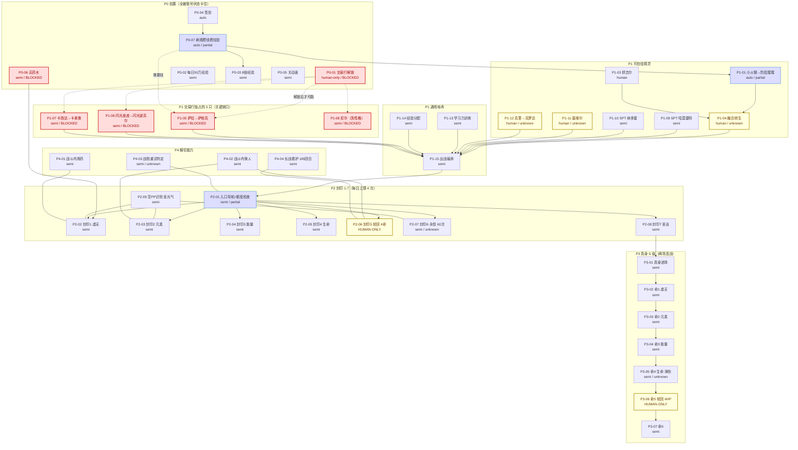

# 谱尼任务图（PUNI TASK GRAPH）

> **用途**：把视频里的"连续操作流"切成**可执行任务单元**，让代码可以逐节点实现、逐节点验收。
> **证据基础**：[PUNI_VIDEO_ANALYSIS.md](PUNI_VIDEO_ANALYSIS.md)（视频时序与机制）、[PUNI_UNKNOWN_MECHANICS.md](PUNI_UNKNOWN_MECHANICS.md)（未知项）、
> [EXISTING_IMPLEMENTATION.md](EXISTING_IMPLEMENTATION.md) / [KNOWN_PROBLEMS.md](KNOWN_PROBLEMS.md)（能力基线）。
> **上游只读**：[plan-from-video.md](plan-from-video.md)、[checklist.md](checklist.md)。

---

## 0. 诚实契约（先读，否则会误读本图）

### 0.1 本图**不是**一份"3 天拿谱尼"的执行计划

当前账号 `hello / <REDACTED_UID>` 的状态让这条路线**从第一个节点就断了**：

- 交易行**未开通**（需 `通关黑暗武斗场 + SPT雷伊 + SPT哈莫雷特`，实测 0/3）；
- 赛尔豆 **0**、金豆 **0**、XIN豆 **5,000**；
- 积累经验池 **5,000**（视频同为 1,722 万）；
- 7 只主力里 **3 只只能从交易行买**（萨帕克 / 闪光波克尔 / 卡奥鲁），且萨帕克是**封印 1 与真身第一命的唯一解**。

**所以：本图描述"若要复现该路线需要哪些任务单元、各自卡在哪"，不是"照着做就能通"。**
见 [UNKNOWN](PUNI_UNKNOWN_MECHANICS.md) 的 **U-A1**（交易行到底是时间门槛还是任务门槛）。

### 0.2 双维度评级（**不要只看一个维度**）

任务书要求 `auto / semi-auto / human-only`。我保留该维度，但**单独加一个 `status` 维度**。
原因：[KNOWN_PROBLEMS.md](KNOWN_PROBLEMS.md) P5–P8 与 [EXISTING_IMPLEMENTATION.md](EXISTING_IMPLEMENTATION.md) §4 明确写着
「连续 N 场战斗稳定完成 = **从未验证**」「点击无结果确认」「无预算/急停」。
只给一个"能自动化"会把"代码写得出来"误读成"今晚就能无人值守跑"。

| 维度 | 取值 | 判据 |
|---|---|---|
| **automatability** | `auto` | 动作集合 ⊆ {进战斗, 点战斗, 点固定技能槽, 等结算, 清弹窗, 再开}；**无需**新的感知或决策模块 |
| | `semi-auto` | 需要**至少一个新的能力模块**（按名选招 / 换精灵 / 用药 / 读战报 / 市场流程 / 长战看护），或需要低频人工确认 |
| | `human-only` | 需要人的数值判断、跨天排期，或**流程本身在视频中未展示**（不可实现，先要查证） |
| **status** | `proven` | 该类动作**真机成功过**（有日志/截图证据） |
| | `partial` | 真机成功过**但不稳定/仅一次**（如 `[f0] floor cleared` 后两次失败） |
| | `todo` | 能力可实现，**尚未做过** |
| | `blocked` | 外部状态阻塞，**写再多代码也过不去** |
| | `unknown` | **机制本身不明**，先查证才能实现（对应 U-* 编号） |

> `automatability` 回答"**写不写得出来**"；`status` 回答"**现在能不能跑**"。
> 二者交叉才是真相，例如：交易行购买 = `semi-auto` + `blocked`（写得出来，但门没开）。

---

## 1. 能力基线（CAP-*）

> 标注来源：✅ 真机验证 / ⚠️ 有代码或人工成功过但不可靠 / ❌ 不存在

| CAP | 能力 | 状态 | 证据 |
|---|---|---|---|
| `CAP-WIN` | 查找游戏窗口 + 几何固定 | ✅ | `seerd pin` 固定到 (300,120,1149,714) |
| `CAP-SHOT` | 区域截图 | ✅ | mean 139.4 ms（[KNOWN_PROBLEMS](KNOWN_PROBLEMS.md) P1） |
| `CAP-OCR` | 中文 OCR（归一化 bbox） | ✅ | mean 468.9 ms 含进程；`.accurate` + zh-Hans |
| `CAP-CLICK` | 局部像素 → 屏幕点击 | ✅ | 公式正确；但**无结果确认**（P5） |
| `CAP-OCRCLICK` | 按 OCR 文本点击 | ⚠️ | `fast.py:click_text`，循环内每次全图 OCR（慢） |
| `CAP-TYPE` | 中文键盘输入 | ⚠️ | `keyboardSetUnicodeString` 路径存在，**未见成功用例** |
| `CAP-HOVERBTN` | 悬停后点"前往/挑战/进入" | ⚠️ | `fast.py:click_hover_button`，未系统验证 |
| `CAP-SPTNAV` | SPT 面板 → 卡片 → 前往 | ⚠️ | **人工**按坐标成功一次（[action-log](action-log.md) 18:16:42 / 18:09） |
| `CAP-BATTLELOOP` | 进战斗→点战斗→点技能→等结算→清弹窗 | ⚠️ `partial` | `[f0] floor cleared` 后两次 `cannot engage - stop` |
| `CAP-STATEMACHINE` | 显式状态机（UNKNOWN/IDLE/BATTLE/RESULT/DIALOG/ERROR） | ❌ | P7：仅 3 值关键词硬匹配，动画中间帧误判 |
| `CAP-CHEAPPERCEPT` | ROI 模板/像素指纹优先、OCR 兜底 | ❌ | P2/P4；实测截图 API 对尺寸不敏感，收益必须来自下游 |
| `CAP-SCSTREAM` | 常驻 SCStream 取最新帧 | ❌ | macOS 15 已移除 `CGWindowListCreateImage`（P1） |
| `CAP-BUDGET` | 次数/时长预算 + 急停 + 暂停恢复 | ❌ | P8，用户硬性要求，未实现 |
| `CAP-HPREAD` | 解析 `159/361` 取血量/血比 | ❌ | **OCR 已能读到该文本**（本报告 11:22 帧），只差解析器 |
| `CAP-PPREAD` | 解析 `使用次数：25/30` | ❌ | 同上（11:22 / 23:22 帧） |
| `CAP-STAGEREAD` | 读 `虚无封印` / `第N命` / `当前回合` | ❌ | 当前回合计数已被**错误地**二值使用（P7） |
| `CAP-LOGREAD` | 读「当前战报」区文本流 | ❌ | **最高性价比**：`圣光气`=空 PP 判定（14:34） |
| `CAP-BUFFCOUNT` | 数左边缘 buff 图标层数 | ❌ | 23:22 帧可见两个「特防」图标，可读性待验 |
| `CAP-SKILLSEL` | 按技能名选 4 格中的一格 | ❌ | 技能格为 2×2 固定布局（11:22 帧） |
| `CAP-SWITCH` | 战斗内换精灵 | ❌ | 「精灵」按钮 = 右下 2×2 的左下 |
| `CAP-ITEM` | 战斗内用药 | ❌ | 「道具」按钮 = 右下 2×2 的右上 |
| `CAP-ESCAPE` | 逃跑 | ❌ | 试过一次即坐标失准失败（[action-log](action-log.md) 17:49） |
| `CAP-MARKET` | 交易行 搜名/筛个体性格/购买 | ❌ + `blocked` | 原语够（click_text + text_input），**但门未开** |
| `CAP-SHOP` | 官方商城购买 | ⚠️ | 仅 OCR 读过 141 件商品，**从未购买**（17:35） |
| `CAP-FUSION` | 融合转生 | ❌ + `unknown` | 流程未完整展示（U-B3） |
| `CAP-CATCH` | 抓宠（削血 + 投胶囊） | ❌ | 26:16 用人手完成 |
| `CAP-TRAIN` | 学习力训练室六选一 | ❌ | 04:48 / 06:47 |
| `CAP-EXPGIVE` | 经验分配器灌注 | ❌ | 04:20 / 05:09 |
| `CAP-TEAM` | 出战队伍编排 | ❌ | 10:34 / 19:22 / 27:51 |
| `CAP-DAILY` | 每日额度读取与调度 | ❌ | 10:16 / 10:22 |

**关键结论**：上表 30 项里，✅ 真机验证 **4 项**（WIN/SHOT/OCR/CLICK，全是最底层原语），
⚠️ **5 项**，❌ **21 项**。**"能看能点能认字"是真的；"能打谱尼"是假的。** 中间 21 个能力都必须新建。

---

## 2. 节点总览（42 个）

| ID | 节点 | 视频时间戳 | auto 评级 | status | 阻塞/未知 |
|---|---|---|---|---|---|
| **P0 前置** | | | | | |
| P0-01 | 交易行解锁 | 未演示 | human-only | `blocked` | 0/3 任务；U-A1 |
| P0-02 | 每日 50 万经验（海盗逃跑） | 02:21–02:35 | semi-auto | `todo` | 需 CAP-ESCAPE |
| P0-03 | 开启 8 倍经验 / 4 倍学习力 | 07:08 / 09:58 | semi-auto | `todo` | 每日限时，U-C3 |
| P0-04 | 每日签到领奖 | 02:43 | **auto** | `todo` | — |
| P0-05 | 关闭出招动画（呼吸模式 + 压缩） | 12:46 | semi-auto | `todo` | 加速比未知 U-B11 |
| P0-06 | 采购体力 / 活力药剂 | 10:58–11:04 | semi-auto | `blocked` | 货币 0；U-C1/U-A12 |
| P0-07 | 货币与经验积累（刷塔） | 06:05 / 06:12 | **auto** | `partial` | 失败即重来（R8） |
| **P1 精灵获取** | | | | | |
| P1-01 | 小火猴 → 烈焰猩猩（练到 36） | 03:10 | **auto** | `partial` | 同 P0-07 循环 |
| P1-02 | 抓皮皮 → 比波（手下留情） | 02:56–03:24 | human-only | `todo` | 可跳过（非 7 主力） |
| P1-03 | 抓吉尔（火山星，融合材料） | 03:17–03:31 | human-only | `todo` | CAP-CATCH |
| P1-04 | 融合转生 → 炎火猴 → 魔焰猩猩 | 03:59–05:09 | human-only | `unknown` | U-B3 流程不明 |
| P1-05 | 交易行买萨拉 → 萨帕克 | 05:44–07:15 | semi-auto | `blocked` | **关键缺口** |
| P1-06 | 交易行买闪光皮皮 → 闪光波克尔 | 09:16–09:52 | semi-auto | `blocked` | **关键缺口** |
| P1-07 | 交易行买卡西达 → 卡奥鲁 | 08:40–09:28 | semi-auto | `blocked` | **关键缺口** |
| P1-08 | 交易行买尼尔（洗性格材料） | 17:16 | semi-auto | `blocked` | — |
| P1-09 | SPT 哈莫雷特 | 05:23 | semi-auto | `todo` | 战斗难度未验证 |
| P1-10 | SPT 纳多雷 | 05:16 / 18:16 | semi-auto | `todo` | 同上 |
| P1-11 | 塞维尔（龙王殿 / 精元孵化） | 07:50 / 16:46 | human-only | `unknown` | U-B4 孵化流程不明 |
| P1-12 | 克里 → 克罗达（唤醒 + 还原 + 验特防6） | 26:16–27:46 | human-only | `unknown` | U-A8 |
| P1-13 | 学习力训练室刷满 | 04:48 / 06:47 | semi-auto | `todo` | 封顶值未知 U-B7 |
| P1-14 | 经验分配器灌注 | 04:20 / 05:09 | semi-auto | `todo` | — |
| P1-15 | 出战队伍编排 | 10:34 / 19:22 / 27:51 | semi-auto | `todo` | — |
| **P2 封印 1–7** | | | | | |
| P2-01 | 谱尼入口导航 + 每日额度检查 | 10:16 / 10:22 | semi-auto | `partial` | 人工到达过一次 |
| P2-02 | 封印 1 虚无（萨帕克单挑，~21 回合） | 11:16–12:40 | semi-auto | `todo` | 最优首攻目标 |
| P2-03 | 封印 2 元素（哈莫耗 PP + 猩猩烧伤） | 12:58–14:58 | semi-auto | `todo` | — |
| P2-04 | 封印 3 能量（同 2） | 12:58–14:58 | semi-auto | `todo` | — |
| P2-05 | 封印 4 生命（猩猩消强 → 哈莫单挑） | 15:04–16:16 | semi-auto | `todo` | — |
| P2-06 | 封印 5 轮回（4 命，125 回合） | 19:52–23:34 | human-only | `todo` | 最复杂 |
| P2-07 | 封印 6 永恒（打 60 次） | 23:40–25:04 | semi-auto | `unknown` | U-A7 "次"的语义 |
| P2-08 | 封印 7 圣洁（三次龙之意志 + 灭碎阵） | 25:04–25:58 | semi-auto | `todo` | 名称互换算 R11 |
| P2-09 | 空 PP 窗口识别（`圣光气`） | 14:34 / 32:45 | semi-auto | `todo` | 横切能力，U-A6 |
| **P3 真身 S 级** | | | | | |
| P3-01 | 真身进场 | 28:12 | semi-auto | `todo` | 进入条件未验证 U-B10 |
| P3-02 | 命 1 虚无（萨帕克 感应+精神强化+龙息） | 28:12–30:04 | semi-auto | `todo` | — |
| P3-03 | 命 2 元素（塞维尔 锁敌+龙之毒） | 30:04–31:35 | semi-auto | `todo` | 毒命中 50% |
| P3-04 | 命 3 能量（相位移动耗 PP → 克罗达漩涡×7） | 31:35–33:34 | semi-auto | `todo` | — |
| P3-05 | 命 4 生命（克罗达偏激防守弹伤） | 33:34–33:41 | semi-auto | `unknown` | U-A8 弹伤原理 |
| P3-06 | 命 5 轮回（4 条 HP） | 36:29–39:03 | human-only | `todo` | 逐回合预判 |
| P3-07 | 命 6（塞维尔 重踏+毒循环） | 39:03–39:56 | semi-auto | `todo` | — |
| **P4 横切** | | | | | |
| P4-01 | 战斗内用药（体力 / 活力） | 13:52 / 16:04 / 39:10 | semi-auto | `todo` | CAP-ITEM |
| P4-02 | 战斗内换精灵 | 19:58–22:10 | semi-auto | `todo` | CAP-SWITCH |
| P4-03 | 战败 / 重试判定 | 10:16 | semi-auto | `unknown` | 失败是否计数 U-A5 |
| P4-04 | 长战看护（165 回合、弹窗/断线恢复） | — | semi-auto | `todo` | 需 P8 预算/急停 |

### 2.1 计数

| automatability | 数量 | 占比 |
|---|---|---|
| `auto` | **3** | 7% |
| `semi-auto` | **31** | 74% |
| `human-only` | **8** | 19% |
| **合计** | **42** | |

| status | 数量 |
|---|---|
| `proven` | **0** |
| `partial` | **3**（P0-07, P1-01, P2-01） |
| `todo` | **27** |
| `blocked` | **6**（P0-01, P0-06, P1-05/06/07/08） |
| `unknown` | **6**（P1-04, P1-11, P1-12, P2-07, P3-05, P4-03） |
| **合计** | **42** |

> **`proven` = 0 是这份图最重要的一行。**
> 42 个节点里，没有任何一个在真机上被完整验证过。3 个 `auto` 也不是"已验证"，
> 而是"动作集合落在已验证原语的包络内"——而那个包络目前只成功过**一层楼**。

---

## 3. Mermaid 依赖图



**读图要点**

1. **左半张图（P0/P1）是"能不能开始"**，右半张图（P2/P3）是"开始后怎么打"。当前阻塞全在左半张。
2. 红色节点 = 外部状态阻塞，**与代码质量无关**。P1-05/06/07 三条虚线都汇到 P0-01，即整个阵容卡在一个开关上。
3. 黄色节点 = 需要人。注意 P2-06 与 P3-06（轮回）是全流程唯二被判 `human-only` 的**战斗**节点 ——
   不是因为难打，而是因为要在"毒剩 1 回合"这种**对方 buff 倒计时**上做预判（见 [UNKNOWN](PUNI_UNKNOWN_MECHANICS.md) U-B6）。
4. `P209`/`P401`/`P402`/`P404` 是**横切能力**，被多条战斗边共享 —— 优先级应高于任何单个封印。

---

## 4. 节点明细

> 字段：`state` 进入前游戏状态｜`action` 动作序列｜`trigger` 触发条件｜`expect` 期望结果｜`verify` 仍需验证。

### 4.1 P0 前置

```yaml
- id: P0-01
  name: 交易行解锁
  ts: "未演示"
  state: "任意场景"
  action: ["未知：需 通关黑暗武斗场", "SPT挑战雷伊", "SPT挑战哈莫雷特"]
  trigger: "决定走交易行路线"
  expect: "交易行面板可进入并可搜索挂单"
  automatability: human-only
  status: blocked
  blocked_by: "0/3 任务未完成；且视频从未演示解锁过程"
  verify: ["U-A1 解锁是任务门槛还是注册满3天的时间门槛", "三条任务各自的路径与难度"]
  caps: []

- id: P0-02
  name: 每日 50 万经验（找 50 级野怪开战即逃跑）
  ts: "02:21-02:35"
  state: "已进入含 50 级野生精灵的场景（如杰拉特）"
  action: ["点击野怪进战斗", "点「逃跑」", "确认逃跑成功", "确认经验入池"]
  trigger: "每日首次登录且该次数未用"
  expect: "经验池 +500,000；当日次数标记为已用"
  automatability: semi-auto
  status: todo
  verify: ["U-A9 逃跑成功率/失败惩罚", "U-A10 副本是否仍刷新杰拉特", "「每天只能获得一次」的判定点"]
  caps: [CAP-ESCAPE, CAP-OCR]

- id: P0-03
  name: 开启 8 倍经验 / 4 倍学习力
  ts: "07:08 / 09:58"
  state: "精灵太空站，与初级班/高级班辅导员对话"
  action: ["打开对话", "点击 8倍经验/4倍学习力 开关", "确认提示变为已开启"]
  trigger: "每日重置后"
  expect: "提示「当日8倍经验与4倍学习力时间已开启」；耗尽后变「已耗尽」（⚠️ 2026-11-03 复核：视频 09:58 帧实际显示的是「当日8倍经验与4倍学习力时间已耗尽」，见 docs/UI_FINDINGS_EXP_BOOST_AND_CHECKIN.md）"
  automatability: semi-auto
  status: todo
  verify: ["U-C3 每日重置时刻", "U-A11 每日时长"]
  caps: [CAP-OCRCLICK]

- id: P0-04
  name: 每日签到领奖
  ts: "00:43（⚠️ 2026-11-03 复核：原记 02:43 有误，该帧实为「经验分配器」面板；签到仅有旁白，无按钮）"
  state: "任意场景，签到入口可见"
  action: ["点击「我要签到」", "清确认弹窗"]
  trigger: "每日首次"
  expect: "奖励入包；签到按钮变为已签到"
  automatability: auto
  status: todo
  verify: ["签到入口坐标未标定"]
  caps: [CAP-OCRCLICK, CAP-CLICK]

- id: P0-05
  name: 关闭出招动画（呼吸模式 + 压缩超长出招动画）
  ts: "12:46"
  state: "系统设置面板"
  action: ["勾选「呼吸模式」", "勾选「压缩超长出招动画」", "保存/关闭"]
  trigger: "首次配置，一次性"
  expect: "出招动画缩短"
  automatability: semi-auto
  status: todo
  verify: ["U-B11 加速比未知（影响全场耗时预算）"]
  caps: [CAP-OCRCLICK]

- id: P0-06
  name: 采购体力 / 活力药剂
  ts: "10:58-11:04"
  state: "商店（价目表 3 页）"
  action: ["打开商店", "购买 高级体力药剂×N", "购买 超级体力药剂×N", "购买 高级活力药剂×N"]
  trigger: "进入谱尼战前"
  expect: "背包内药剂数量达标"
  automatability: semi-auto
  status: blocked
  blocked_by: "赛尔豆 0 / 金豆 0 / XIN豆 5000；按 特级300×100 = 30,000 计仍不足"
  verify: ["U-C1 三种货币图标对应关系", "U-A12 买高级还是特级×100"]
  caps: [CAP-SHOP, CAP-OCR]

- id: P0-07
  name: 货币与经验积累（刷塔）
  ts: "06:05 / 06:12"
  state: "勇者之塔 / 试炼之塔入口"
  action: ["进入塔", "选择楼层", "进战斗→点战斗→点技能→等结算→清弹窗→再开"]
  trigger: "需要赛尔豆或练级"
  expect: "层数推进 + 经验/赛尔豆入账"
  automatability: auto
  status: partial
  verify: ["R8：失败即『需要重新开始』→ 必须断点续跑", "每层收益未统计"]
  caps: [CAP-BATTLELOOP]
```

### 4.2 P1 精灵获取

```yaml
- id: P1-01
  name: 小火猴 → 烈焰猩猩（练到 36 级）
  ts: "03:10"
  state: "小火猴出战，试炼之塔/野外"
  action: ["循环 P0-07 的战斗循环", "达到 Lv36 后自动进化"]
  trigger: "需要融合材料主体"
  expect: "精灵变为烈焰猩猩 Lv36"
  automatability: auto
  status: partial
  verify: ["进化等级 36 是否本服一致"]
  caps: [CAP-BATTLELOOP]

- id: P1-02
  name: 抓皮皮 → 比波（手下留情）
  ts: "02:56-03:24"
  state: "克洛斯星"
  action: ["遇皮皮", "用「手下留情」削到 1 HP", "投胶囊"]
  trigger: "可选（抓宠工具，非 7 主力）"
  expect: "获得皮皮"
  automatability: human-only
  status: todo
  verify: ["U-B9 胶囊成功率与血量门槛"]
  caps: [CAP-CATCH]

- id: P1-03
  name: 抓吉尔（火山星，融合副宠）
  ts: "03:17-03:31"
  state: "火山星野外"
  action: ["遇吉尔 Lv17", "削血", "投胶囊"]
  trigger: "融合转生前"
  expect: "获得吉尔"
  automatability: human-only
  status: todo
  verify: ["U-B9", "U-A10 刷新点"]
  caps: [CAP-CATCH]

- id: P1-04
  name: 融合转生 → 炎火猴 → 魔焰猩猩
  ts: "03:59-05:09"
  state: "融合转生仓；拥有 烈焰猩猩(36)+吉尔(17)"
  action: ["主宠/副宠放入", "材料位放任意材料", "生成红色元神珠", "元神赋形", "孵化", "经验灌注至 100"]
  trigger: "材料齐备"
  expect: "获得 炎火猴 → 进化 魔焰猩猩 Lv100"
  automatability: human-only
  status: unknown
  verify: ["U-B3 完整 UI 流程（顺序/材料要求/孵化时长）", "U-A13 材料位是否真的任意"]
  caps: [CAP-FUSION, CAP-EXPGIVE]

- id: P1-05
  name: 交易行买萨拉 → 萨帕克
  ts: "05:44-07:15"
  state: "交易行面板（已解锁）"
  action: ["筛选-名称=萨拉", "排序=价格 低到高", "按 个体31 / 性格 沉着 选具体挂单", "购买"]
  trigger: "交易行已解锁且有余额"
  expect: "获得萨拉 → 练到 72 进化 萨帕克 → 拉到 100"
  automatability: semi-auto
  status: blocked
  blocked_by: "交易行未解锁（P0-01）+ 赛尔豆 0"
  verify: ["U-C1 价格单位与货币", "U-C2 挂单存量", "U-A2 是否仍有「萨拉」在售"]
  caps: [CAP-MARKET, CAP-TYPE, CAP-BATTLELOOP]

- id: P1-06
  name: 交易行买闪光皮皮 → 闪光波克尔
  ts: "09:16-09:52"
  state: "交易行面板"
  action: ["名称=闪光皮皮", "只取 高个体 + 加速性格", "购买", "练到 99", "速度学习力刷满"]
  trigger: "交易行已解锁"
  expect: "获得 闪光波克尔，带「同生共死」"
  automatability: semi-auto
  status: blocked
  blocked_by: "交易行未解锁 + 余额"
  verify: ["U-C2", "U-A2"]
  caps: [CAP-MARKET, CAP-TRAIN]

- id: P1-07
  name: 交易行买卡西达 → 卡奥鲁
  ts: "08:40-09:28"
  state: "交易行面板"
  action: ["名称=卡西达", "个体越高越好", "购买", "练到 100", "攻击+速度学习力"]
  trigger: "交易行已解锁"
  expect: "获得 卡奥鲁"
  automatability: semi-auto
  status: blocked
  blocked_by: "交易行未解锁 + 余额（5.6W ≈ 56,000）"
  verify: ["U-C1", "U-C2"]
  caps: [CAP-MARKET]

- id: P1-08
  name: 交易行买尼尔（塞维尔洗性格材料）
  ts: "17:16"
  state: "交易行面板"
  action: ["名称=尼尔", "个体 28 左右即可", "购买"]
  trigger: "塞维尔性格不是「任意+特防」"
  expect: "获得尼尔，可用于基因重组"
  automatability: semi-auto
  status: blocked
  blocked_by: "交易行未解锁 + 余额（约 3W）"
  verify: ["U-C2"]
  caps: [CAP-MARKET]

- id: P1-09
  name: SPT 哈莫雷特
  ts: "05:23"
  state: "SPT 面板 → 卡兰星系 尼古尔星/塔克星"
  action: ["SPT 卡片 hover", "点「前往」", "进战斗并击败", "领取/孵化"]
  trigger: "需要龙系主坦"
  expect: "获得 哈莫雷特"
  automatability: semi-auto
  status: todo
  verify: ["视频只显示「已击败」，战斗本身未演示 → 难度未知 U-C5"]
  caps: [CAP-SPTNAV, CAP-BATTLELOOP]

- id: P1-10
  name: SPT 纳多雷
  ts: "05:16 / 18:16"
  state: "SPT 面板 → 帕诺星系 双子阿尔法星-阿尔法星岩地"
  action: ["SPT 卡片 → 前往", "击败", "孵化"]
  trigger: "需要「属性反转」"
  expect: "获得 纳多雷"
  automatability: semi-auto
  status: todo
  verify: ["同 P1-09；孵化流程 U-B4"]
  caps: [CAP-SPTNAV, CAP-BATTLELOOP]

- id: P1-11
  name: 塞维尔（龙王殿 / 精元孵化）
  ts: "07:50 / 16:46"
  state: "SPT → 龙王殿 线；或 精元孵化器"
  action: ["打通 龙王殿 线", "获得精元", "孵化", "若无精元则未知"]
  trigger: "需要「锁敌」与「龙之毒」"
  expect: "获得 塞维尔"
  automatability: human-only
  status: unknown
  verify: ["U-B4 精元孵化完整流程与时长", "U-A2 龙王殿当前是否可挑战"]
  caps: []

- id: P1-12
  name: 克里 → 克罗达（技能唤醒 + 还原 + 验特防6）
  ts: "26:16-27:46"
  state: "野外遇克里 Lv18"
  action: ["同生共死削血 + 投胶囊", "升到 Lv54", "花 100 赛尔豆 技能唤醒「偏激防守」", "精灵还原药剂还原到 Lv1", "校验 特防=6（否则重洗）"]
  trigger: "需要真身第四命弹伤"
  expect: "克罗达 Lv1，面板 攻6/防6/特攻6/特防6/速7/体13"
  automatability: human-only
  status: unknown
  verify: ["U-A8 「特防=6」为何决定弹伤量（原理未解释）", "U-B6 还原药剂规则", "U-B5 技能唤醒菜单路径"]
  caps: [CAP-CATCH]

- id: P1-13
  name: 学习力训练室刷满
  ts: "04:48 / 06:47"
  state: "学习力训练室"
  action: ["选六项之一（攻/防/特攻/特防/速/体）", "反复训练，一次 +4", "重复至目标值"]
  trigger: "精灵等级达标后"
  expect: "目标两项学习力刷满"
  automatability: semi-auto
  status: todo
  verify: ["U-B7 单项上限与总量上限"]
  caps: [CAP-TRAIN]

- id: P1-14
  name: 经验分配器灌注
  ts: "04:20 / 05:09"
  state: "实验室 经验分配器"
  action: ["选择目标精灵", "输入/拉满经验值", "确认灌注"]
  trigger: "经验池有余额"
  expect: "目标精灵升级"
  automatability: semi-auto
  status: todo
  verify: ["单次上限（视频见 1,000,000）"]
  caps: [CAP-EXPGIVE]

- id: P1-15
  name: 出战队伍编排
  ts: "10:34 / 19:22 / 27:51"
  state: "进战前的精灵选择面板"
  action: ["选择本关所需精灵（封印1 只带萨帕克；封印5/真身 7 只全带）", "确认"]
  trigger: "进入某封印/真身前"
  expect: "面板显示所需阵容"
  automatability: semi-auto
  status: todo
  verify: ["队伍上限是否为 6（视频称「7只全带」→ 需确认是否含替补）"]
  caps: [CAP-TEAM]
```

### 4.3 P2 封印 1–7

```yaml
- id: P2-01
  name: 谱尼入口导航 + 每日额度检查
  ts: "10:16 / 10:22"
  state: "任意场景"
  action: ["打开 SPT", "进入 太空站左翼", "进入 勇者之塔神秘领域", "点击谱尼", "读取今日剩余挑战次数"]
  trigger: "准备挑战封印"
  expect: "谱尼封印选择面板；剩余次数 > 0"
  automatability: semi-auto
  status: partial
  verify: ["U-A5 失败是否消耗次数", "U-C3 次数重置时刻", "入口路径唯一证据是人工实测（视频未演示，R3）"]
  caps: [CAP-SPTNAV, CAP-DAILY]

- id: P2-02
  name: 封印 1 虚无（萨帕克单挑）
  ts: "11:16-12:40"
  state: "谱尼面板，入口显示「虚无封印」；只带萨帕克"
  action: ["点战斗", "开局连点「感应」叠特防", "叠够后「精神强化」", "「七彩龙息」输出", "HP 低于阈值 → 超级体力药剂"]
  trigger: "面板出现「虚无封印」"
  expect: "战报出现「谱尼被击败了」；约 21 回合"
  automatability: semi-auto
  status: todo
  verify: ["感应 PP=30 是否本版本一致", "buff 层数能否用图标数读出", "HP 阈值取 1/3 是否最优"]
  caps: [CAP-SKILLSEL, CAP-HPREAD, CAP-PPREAD, CAP-STAGEREAD, CAP-ITEM]

- id: P2-03
  name: 封印 2 元素（哈莫耗 PP + 魔焰烧伤）
  ts: "12:58-14:58"
  state: "「元素、能量封印」；带 哈莫雷特 + 魔焰猩猩"
  action: ["哈莫：龙之意志", "一直「回避」", "龙之意志续一次", "龙王波打血", "PP 低 → 高级活力药剂", "见「圣光气」→ 换魔焰猩猩", "火焰漩涡刷烧伤至死"]
  trigger: "面板出现「元素」封印"
  expect: "谱尼被烧伤磨死"
  automatability: semi-auto
  status: todo
  verify: ["U-A6 谱尼 PP 池是否一致", "回避 PP=15", "烧伤每回合 -1000 是否本版本"]
  caps: [CAP-SKILLSEL, CAP-SWITCH, CAP-LOGREAD, CAP-PPREAD]

- id: P2-04
  name: 封印 3 能量（同 封印 2）
  ts: "12:58-14:58"
  state: "同上"
  action: ["与 P2-03 完全相同"]
  trigger: "面板出现「能量」封印"
  expect: "谱尼被击败"
  automatability: semi-auto
  status: todo
  verify: ["与封印2 是否真的数值同构（视频「只展示一次」）"]
  caps: [CAP-SKILLSEL, CAP-SWITCH, CAP-LOGREAD]

- id: P2-05
  name: 封印 4 生命（猩猩消强 → 哈莫单挑）
  ts: "15:04-16:16"
  state: "「生命封印」"
  action: ["魔焰猩猩「压迫」消强（可送）", "换哈莫雷特", "龙之意志 ×2", "全程回避", "补一轮龙之意志", "两发「龙王灭碎阵」收尾"]
  trigger: "面板出现「生命封印」"
  expect: "谱尼被击败"
  automatability: semi-auto
  status: todo
  verify: ["「两发搓死」是否依赖特定面板（攻369）"]
  caps: [CAP-SKILLSEL, CAP-SWITCH, CAP-PPREAD]

- id: P2-06
  name: 封印 5 轮回（4 条命，125 回合）★最难
  ts: "19:52-23:34"
  state: "「轮回封印」；7 只全带"
  action:
    - "第1命：猩猩压迫 → 塞维尔龙女之声 → 哈莫龙之意志+回避耗PP → 纳多雷属性反转 → 塞维尔龙之毒 → 闪光波克尔同生共死 → 哈莫灭碎阵 → 萨帕克收"
    - "第2命：塞维尔毒 + 同生共死"
    - "第3命：哈莫单挑"
    - "第4命：萨帕克单挑（感应→精神强化→乐镜迷踪）"
  trigger: "面板出现「轮回封印」"
  expect: "约 125 回合内 4 条命全清"
  automatability: human-only
  status: todo
  verify: ["U-B6 对方 buff 剩余回合是否可读（决定换人时机能否自动化）", "4 条命是否在同一场战斗内（回合计数连续 → 是）"]
  caps: [CAP-SWITCH, CAP-LOGREAD, CAP-BUFFCOUNT, CAP-BUDGET]

- id: P2-07
  name: 封印 6 永恒（打 60 次）
  ts: "23:40-25:04"
  state: "「永恒封印」"
  action: ["猩猩压迫 → 纳多雷属性反转", "哈莫龙之意志 → 回避耗到「圣光气」", "龙王波连续输出 60 次", "注意别被反伤反死"]
  trigger: "面板出现「永恒封印」"
  expect: "满 60 次后通关"
  automatability: semi-auto
  status: unknown
  verify: ["U-A7 「60次」= 命中？回合？有效伤害？（视频只做快进）", "谱尼 HP 会回升（观测 214→294→334/414）→ 判据不可是血条"]
  caps: [CAP-LOGREAD, CAP-SKILLSEL, CAP-STAGEREAD]

- id: P2-08
  name: 封印 7 圣洁（三次龙之意志 + 灭碎阵）
  ts: "25:04-25:58"
  state: "「圣洁封印」"
  action: ["猩猩压迫", "纳多雷属性反转（谱尼转地面系）", "哈莫 龙之意志 ×3", "龙王灭碎阵单挑"]
  trigger: "面板出现「圣洁封印」"
  expect: "谱尼被击败，1-7 封印全清"
  automatability: semi-auto
  status: todo
  verify: ["名称互换（作者文字版 6/7 写反）已确认，R11"]
  caps: [CAP-SKILLSEL, CAP-SWITCH]

- id: P2-09
  name: 空 PP 窗口识别（圣光气）【横切】
  ts: "14:34 / 32:45"
  state: "任意谱尼战斗中"
  action: ["读「当前战报」滚动文本", "匹配 `圣光气`", "标记 BOSS_PP_EMPTY，放宽输出条件"]
  trigger: "战报出现 `圣光气`"
  expect: "状态机进入「可安全输出」分支"
  automatability: semi-auto
  status: todo
  verify: ["U-A6 `圣光气` 是否等价于『全部招式空 PP』（可能只是某一招）"]
  caps: [CAP-LOGREAD]
```

### 4.4 P3 真身 S 级

```yaml
- id: P3-01
  name: 真身进场
  ts: "28:12"
  state: "7 封印全清；谱尼面板可选真身"
  action: ["选择 S 级真身", "确认 7 只阵容", "进入战斗"]
  trigger: "7 封印完成"
  expect: "画面出现「谱尼真身」+「第一命」"
  automatability: semi-auto
  status: todo
  verify: ["U-B10 真身是否必须先清 7 封印", "U-A3 S 级是否含普通真身全部奖励"]
  caps: [CAP-TEAM, CAP-STAGEREAD]

- id: P3-02
  name: 命 1 虚无（萨帕克）
  ts: "28:12-30:04"
  state: "「谱尼真身」+「第一命」"
  action: ["感应保命优先", "精神强化提特攻", "七彩龙息输出", "HP 低 → 超级体力药剂"]
  trigger: "读到「第一命」"
  expect: "画面切到「第二命」"
  automatability: semi-auto
  status: todo
  verify: ["命 1 是否与封印1 同构"]
  caps: [CAP-SKILLSEL, CAP-HPREAD, CAP-STAGEREAD, CAP-ITEM]

- id: P3-03
  name: 命 2 元素（塞维尔 锁敌 + 龙之毒）
  ts: "30:04-31:35"
  state: "「第二命」"
  action: ["萨帕克先打点血", "换塞维尔", "锁敌（命中+1）", "龙之毒反复挂毒", "毒到死"]
  trigger: "读到「第二命」"
  expect: "切到「第三命」"
  automatability: semi-auto
  status: todo
  verify: ["龙之毒命中 50% → 需重试逻辑", "中毒伤害每回合 1000 是否本版本"]
  caps: [CAP-SWITCH, CAP-SKILLSEL, CAP-LOGREAD]

- id: P3-04
  name: 命 3 能量（相位移动耗 PP → 克罗达漩涡×7）
  ts: "31:35-33:34"
  state: "「第三命」"
  action: ["萨帕克上感应", "耗光谱尼 5 个圣灵魔闪光", "全程相位移动躲千烈虚光闪/旋灭裂空阵（约 20 个）", "等连续圣光气", "塞维尔过渡", "换克罗达 意念集中 ×2", "漩涡点 7 下冻死"]
  trigger: "读到「第三命」"
  expect: "切到「第四命」"
  automatability: semi-auto
  status: todo
  verify: ["相位移动 PP=20 与『能躲约20个技能』是否同一回事"]
  caps: [CAP-SKILLSEL, CAP-SWITCH, CAP-PPREAD, CAP-LOGREAD]

- id: P3-05
  name: 命 4 生命（克罗达 偏激防守弹伤）
  ts: "33:34-33:41"
  state: "「第四命」；克罗达 Lv1 特防6 在场上"
  action: ["使用「偏激防守」", "等谱尼攻击 → 伤害反弹 → 谱尼被击败", "快攻收尾"]
  trigger: "读到「第四命」"
  expect: "切到「第五命」"
  automatability: semi-auto
  status: unknown
  verify: ["U-A8 反弹比例与『特防=6』的关系（原理未解释）", "是否依赖谱尼自选攻击招"]
  caps: [CAP-SKILLSEL]

- id: P3-06
  name: 命 5 轮回（4 条 HP）★第二难
  ts: "36:29-39:03"
  state: "「第五命」"
  action:
    - "(1) 萨帕克感应扛 → 相位移动耗光千烈虚光闪 → 纳多雷属性反转 → 地裂磨 → 闪光波克尔同生共死 → 卡奥鲁补刀 → 塞维尔锁敌+龙之毒 → 毒剩1回合时提前换萨帕克接"
    - "(2) 塞维尔丢毒提速 → 仙女龙补掉"
    - "(3) 塞维尔丢毒毒死"
  trigger: "读到「第五命」"
  expect: "切到「第六命」"
  automatability: human-only
  status: todo
  verify: ["U-B6 对方中毒剩余回合是否可读（『剩 1 回合时提前换人』是纯预判，不可读则无法自动化）"]
  caps: [CAP-SWITCH, CAP-BUFFCOUNT, CAP-LOGREAD, CAP-BUDGET]

- id: P3-07
  name: 命 6（塞维尔 重踏 + 毒循环）
  ts: "39:03-39:56"
  state: "「第六命」（无对应封印）"
  action: ["塞维尔 重踏 → 龙之毒 循环", "初级活力药剂补 PP", "毒死收工"]
  trigger: "读到「第六命」"
  expect: "谱尼真身被击败；成就达成"
  automatability: semi-auto
  status: todo
  verify: ["U-A3 成就/奖励内容"]
  caps: [CAP-SKILLSEL, CAP-PPREAD, CAP-ITEM]
```

### 4.5 P4 横切

```yaml
- id: P4-01
  name: 战斗内用药（体力 / 活力）
  ts: "13:52 / 16:04 / 39:10"
  state: "任意战斗中"
  action: ["点「道具」", "选择药剂", "确认", "校验 HP/PP 已回升"]
  trigger: "HP < 阈值 或 关键技能 PP < 阈值"
  expect: "HP/PP 回升；消耗回合"
  automatability: semi-auto
  status: todo
  verify: ["用药是否消耗回合（影响时序）", "药剂栏排序是否稳定"]
  caps: [CAP-ITEM, CAP-HPREAD, CAP-PPREAD, CAP-CLICK]

- id: P4-02
  name: 战斗内换精灵
  ts: "19:58-22:10"
  state: "任意战斗中"
  action: ["点「精灵」", "选择目标精灵", "确认", "校验上场精灵名"]
  trigger: "当前精灵完成使命 / 濒死 / 战术切换"
  expect: "目标精灵上场；战报出现「XX登场了」"
  automatability: semi-auto
  status: todo
  verify: ["换人是否消耗回合", "阵亡后是否强制换人"]
  caps: [CAP-SWITCH, CAP-LOGREAD]

- id: P4-03
  name: 战败 / 重试判定
  ts: "10:16"
  state: "战斗结算后"
  action: ["读结算面板文本", "判定 胜利/失败", "失败则回 P2-01 重新进入", "核对剩余次数"]
  trigger: "战斗结束"
  expect: "状态机正确回到可重试状态"
  automatability: semi-auto
  status: unknown
  verify: ["U-A5 失败是否消耗每日 4 次（旁白暗示不消耗，但未实证）"]
  caps: [CAP-STAGEREAD, CAP-DAILY]

- id: P4-04
  name: 长战看护（165 回合、弹窗/断线恢复）
  ts: "—（真身观测到 165 回合）"
  state: "任意长战斗"
  action: ["回合数单调性校验", "长时间无变化 → 升级 UNKNOWN", "弹窗（成就/活动/公告）识别并关闭", "断线重连后状态恢复", "预算耗尽则安全停机"]
  trigger: "战斗回合数 > 阈值 或 无进展超时"
  expect: "不误判结束、不无限盲点、可安全中断"
  automatability: semi-auto
  status: todo
  verify: ["需先实现 KNOWN_PROBLEMS P8（预算/急停）与 P5（点击确认）"]
  caps: [CAP-STATEMACHINE, CAP-BUDGET]
```

---

## 5. 五个最高价值的"可自动化"节点

> 口径：在 `auto` + `semi-auto` 里挑**投入产出比最高**的，且优先横切能力（一次投入、多处复用）。

| 排名 | 节点 | 为什么最值 | 依赖 | 前置代价 |
|---|---|---|---|---|
| **1** | **P2-09 空 PP 窗口识别（`圣光气`）** | 全套路的核心判据，**7 个封印 + 真身 6 命全部复用**。一个字符串匹配替代"按回合数猜"，是唯一能同时提升所有战斗可靠性的单点 | `CAP-LOGREAD` | 低：只需 ROI OCR 战报区 |
| **2** | **P4-04 长战看护 + 状态机** | 165 回合的战斗没有它就是不可托管。同时修掉 P5/P7/P8 三个已知问题（点击确认、误判、预算/急停） | `CAP-STATEMACHINE`, `CAP-BUDGET` | 中：要重建战斗循环而非改参数 |
| **3** | **P2-02 封印 1 虚无** | **状态空间最小的真实谱尼战斗**（单精灵、4 技能、~21 回合、无换人）；且是"第一个能验证整套框架对不对"的关卡 | `CAP-SKILLSEL`, `CAP-HPREAD`, `CAP-PPREAD`, `CAP-STAGEREAD`, `CAP-ITEM` | 中：但一次建成 5 个能力 |
| **4** | **P0-07 + P1-01 刷塔练级/攒钱循环** | 唯一落进"已验证原语包络"的高价值节点；是**所有**需要等级与赛尔豆的节点（几乎全部）的公共前置 | `CAP-BATTLELOOP` | 低：但必须先补**失败即重来**的断点续跑（R8） |
| **5** | **P2-01 谱尼入口导航 + 每日额度检查** | 纯导航 + 一次读屏，无战斗风险；决定"今天还能打几次"，是所有封印节点的闸门 | `CAP-SPTNAV`, `CAP-DAILY` | 低：人工已成功到达过一次（18:16:42） |

**没进前五但值得单独说**：`P1-05/06/07`（交易行买 3 只）技术上属 `semi-auto` 且原语齐备，
**投入产出比其实最高**——但它们 `blocked`，**不是工程问题**。只要门一开，这三条能在很短时间内补齐，
且是"能否打谱尼"的**唯一**决定因素（缺萨帕克 = 封印 1 与真身命 1 无解）。

---

## 6. 关键路径与真正的瓶颈

```
P0-01 交易行解锁 ──(硬阻塞)──> P1-05/06/07 买 3 只 ──> P1-15 阵容齐 ──> P2-02 封印1
      ↑                                                   ↑
   外部状态                                         P0-07 刷塔（等级+赛尔豆）
```

1. **关键路径上的第一个节点是 `P0-01`，而它是 `human-only + blocked`。**
   这意味着**本图无法靠增加算力/代码推进**——必须先在游戏里把三个任务做掉，或者证伪"需要这三个任务"。
2. 若 `U-A1` 查明交易行实为**注册满 3 天自动解锁**，则 `P0-01` 从 `human-only` 直接变 `auto`，
   整张图的可执行部分立刻扩大 —— **这是全项目最高杠杆的一次查证**。
3. 即便交易行解锁，**赛尔豆 0 与挂单价格 ~5W 的缺口仍在**：需要 `P0-07` 刷塔产出。
   每层收益未统计（U-C6），因此"要刷多久"目前**无法回答**。
4. 战斗侧的瓶颈不是难度，而是**可靠性**：42 个节点里 27 个 `todo`、6 个 `unknown`，
   核心是三个能力（状态机 / 战报读 / 换人用药）几乎覆盖全部战斗节点。

---

## 7. 与视频的对应关系（可追溯性）

| 视频段落 | 时间戳 | 对应节点 |
|---|---|---|
| 注册 / 下载 / 交易行预告 | 00:09–00:29 | P0-01 |
| 第一天培养 | 00:29–08:34 | P0-02/03/04, P1-01–P1-14 |
| 第二天补齐阵容 + 买药 | 08:34–11:16 | P1-05/06/07/15, P0-06, P2-01 |
| 封印 1 虚无 | 11:16–12:40 | P2-02 |
| 封印 2/3 元素·能量 | 12:58–14:58 | P2-03, P2-04, P2-09 |
| 封印 4 生命 | 15:04–16:16 | P2-05 |
| 第三天最后两只 | 16:34–19:16 | P1-11, P1-12 |
| 封印 5 轮回 | 19:52–23:34 | P2-06 |
| 封印 6 永恒 | 23:40–25:04 | P2-07 |
| 封印 7 圣洁 | 25:04–25:58 | P2-08 |
| 真身 S 级 6 命 | 27:51–39:56 | P3-01–P3-07 |
| 作者文字版总结 | 39:56–40:47 | 校对用（R11） |

---

## 8. 每个节点的"仍需验证"汇总

> 完整展开见 [PUNI_UNKNOWN_MECHANICS.md](PUNI_UNKNOWN_MECHANICS.md)。此处只列**阻塞实现**的项。

| 节点 | 必须先查清什么 | 否则后果 |
|---|---|---|
| P0-01 | U-A1 解锁机制 | 整图无法推进 |
| P1-04 | U-B3 融合完整流程 | 魔焰猩猩拿不到 |
| P1-11 | U-B4 精元孵化流程 | 塞维尔拿不到 |
| P1-12 | U-A8 特防=6 与弹伤关系 | 克罗达白练，命 4 打不死 |
| P2-06 | U-B6 对方 buff 剩余回合可读性 | 换人时机无法自动化 |
| P2-07 | U-A7 "60次"语义 | 无法写终止条件 |
| P3-06 | U-B6 同上 | 同 P2-06 |
| P4-03 | U-A5 失败是否计数 | 重试策略可能违规 |
| P0-06 | U-C1 货币对应 | 买错/买不起 |
| 全部战斗 | U-A6 谱尼 PP 池一致性 | 整套"耗 PP"打法可能失效 |

---

## 附：版本与来源

- 本图基于视频 `BV1Fu8h6YEAz`（40:48，417 抽样帧）+ 本机实测 [state.md](state.md) / [action-log.md](action-log.md)。
- 能力基线取自 [EXISTING_IMPLEMENTATION.md](EXISTING_IMPLEMENTATION.md)、[KNOWN_PROBLEMS.md](KNOWN_PROBLEMS.md)（Round 0/1），
  并于 `seerauto/` 现状（仅 `capture/geometry/window/perf/errors`，无 `vision`/`state`/`executor`/`tasks/battle`）核对。
- **未在真机上执行任何本图节点**。所有 `status` 均为对既有记录的归纳，不含本轮的新实测。
