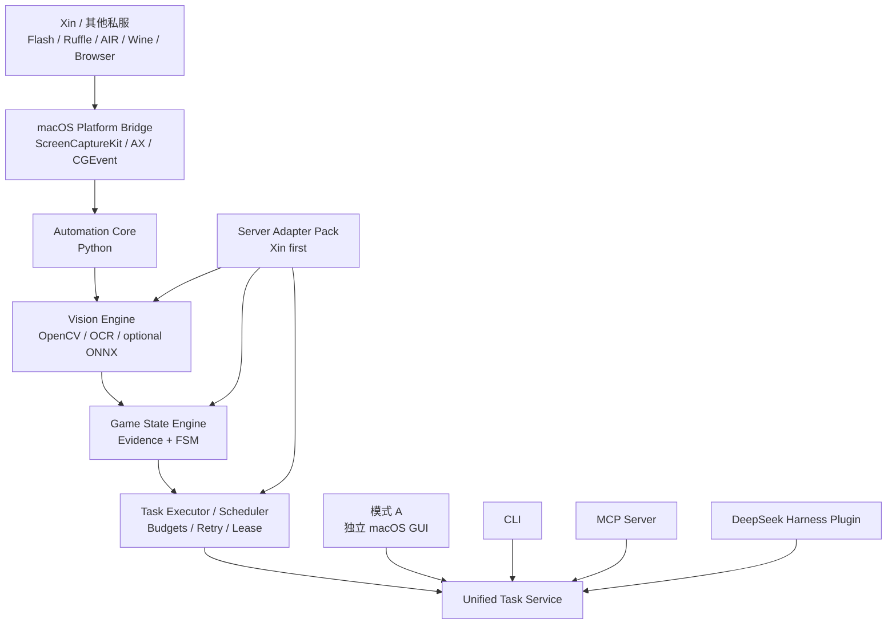
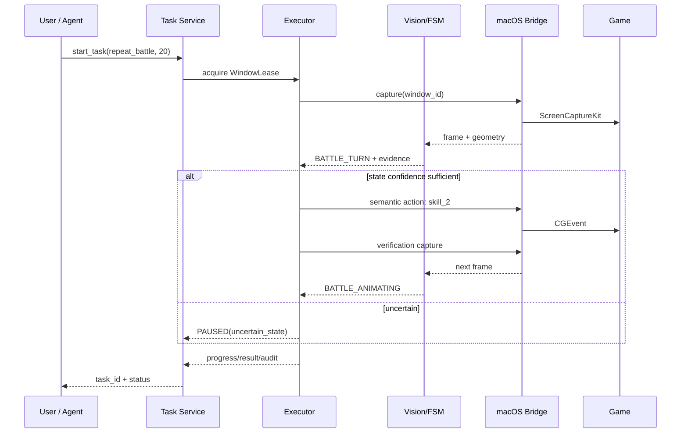

# 《赛尔号 Xin 计划》及多私服 macOS 优先视觉自动化与 Agent 扩展系统工程研究报告

## Executive Summary

本研究的结论是：**在 macOS 上构建一个以 Xin 服为首要目标、同时能够通过适配包扩展到其他赛尔号私人服务器的 BetterGI 式纯视觉自动化工具，在技术上是可行的；最合理的产品形态不是把 BetterGI 移植到 macOS，而是重新实现 macOS 平台层，同时复用其“截图→视觉识别→状态判断→任务执行→结果验证→调度/脚本”的产品思想。** BetterGI 当前仓库仍明确以 Windows 为目标，截图层包含 BitBlt、Windows Graphics Capture、DWM shared-surface 等 Windows 特定机制，其源码中也存在独立的 `Fischless.GameCapture`、`Fischless.WindowsInput` 等 Windows 组件；这些不能成为 macOS 实现基础。另一方面，BetterGI 的 `CaptureContent`、OpenCV/OCR 管线、任务模块、脚本系统和状态驱动设计非常值得作为架构参考。citeturn843069view1turn520693search2turn520693search3turn139463search22

首个 MVP 推荐采用**混合架构**：Python 负责 OpenCV、OCR、状态机、任务调度、适配包和测试；一个很小的 Swift helper 专门负责 ScreenCaptureKit、Accessibility、CGEvent 和 macOS 权限；PySide6 提供第一版独立 GUI。这样比“纯 Python”更可靠地使用现代 macOS 捕获 API，又比“全 Swift”更适合快速迭代计算机视觉和游戏适配。长期产品仍建议保持同样的进程边界：即便未来把 GUI 换成 SwiftUI，视觉/任务核心也无需重写。ScreenCaptureKit 自 macOS 12.3 引入，Apple 已把老的 `CGWindowListCreateImage` 标记为 deprecated，并明确推荐 ScreenCaptureKit；因此建议产品最低版本从 **macOS 13 Ventura** 起步，并把 macOS 12.3–12.x 视作非首发承诺兼容目标。citeturn690973search7turn690973search4turn309463search3

**AI 不能成为自动化闭环的一部分。** 模式 A 应当在完全没有 DeepSeek、Claude、Codex 或任何外部 API 时正常工作；模式 B 只是给同一个 Task Service 增加 MCP、CLI 和 DeepSeek Harness adapter。当前 DeepSeek Harness 官方项目确实存在真实 Cordis 插件和工具 API：插件可导出 `apply(ctx)`，通过 `inject=['tools']` 等待工具服务，并使用 `ctx.tools.register(defineTool(...))` 注册工具。其官方仓库目前仍标记为 Developer Preview，当前根 `package.json` 显示 `0.2.2-alpha.2` 且要求 Node `>=24.9.0`，因此必须做版本锁定和兼容适配层，而不能让自动化核心依赖 Harness 内部实现。citeturn429956search4turn429956search0turn429956search2turn429956search8

对于 Xin 服本身，现有公开证据远不足以证明其在 macOS 上究竟通过浏览器、Flash projector、AIR、Ruffle、Wine/CrossOver 还是原生客户端运行。公开 `xin_tool` 仓库确实面向 Xin 服，README 显示 v1.4.1 于 2025 年 5 月更新，并包括学习力地点、属性克制、材料、计算器等功能；但它是 Java/Windows 数据辅助工具，而且仓库页面明确提示**未指定许可证**。它不能被当作 Xin 客户端运行方式的证据，也不宜直接复制其源码或数据到本项目。citeturn843069view0

Ruffle 是值得重点实验的 Flash 容器候选：官方提供 macOS 桌面应用和 Apple Silicon 可用的发行方式，但其官方兼容页仍显示 AVM1/AVM2 API 并未达到 100%，所以不能假设 Xin 或其他私服一定可直接迁移到 Ruffle。Adobe 原生 Flash Player 已于 2020 年 12 月 31 日终止支持，并于 2021 年 1 月开始阻止普通 Flash 内容运行；HARMAN AIR 仍提供 macOS SDK。因此**客户端容器验证必须成为 P0，而不是隐藏在开发后期。** citeturn554904search0turn554904search1turn554904search7turn554904search5

本次研究同时生成了要求的 12 份可独立保存 Markdown 工程文档：

| 文件 | 内容 |
|---|---|
| [00_RESEARCH_EVIDENCE.md](sandbox:/mnt/data/seer_automation_research/00_RESEARCH_EVIDENCE.md) | 项目、源码、官方文档、证据等级与未知项 |
| [01_PRODUCT_REQUIREMENTS.md](sandbox:/mnt/data/seer_automation_research/01_PRODUCT_REQUIREMENTS.md) | 双模式产品需求、Xin 优先与多私服范围 |
| [02_MACOS_TECHNICAL_RESEARCH.md](sandbox:/mnt/data/seer_automation_research/02_MACOS_TECHNICAL_RESEARCH.md) | ScreenCaptureKit、CGEvent、权限、Flash、Retina |
| [03_SYSTEM_ARCHITECTURE.md](sandbox:/mnt/data/seer_automation_research/03_SYSTEM_ARCHITECTURE.md) | 共享核心、进程边界、FSM、Mermaid 架构与时序 |
| [04_VISION_AUTOMATION_IMPLEMENTATION.md](sandbox:/mnt/data/seer_automation_research/04_VISION_AUTOMATION_IMPLEMENTATION.md) | OpenCV/OCR、状态识别、战斗与脚本设计 |
| [05_STANDALONE_MAC_APP_PLAN.md](sandbox:/mnt/data/seer_automation_research/05_STANDALONE_MAC_APP_PLAN.md) | GUI、运行时、签名、打包和安装 |
| [06_AGENT_INTEGRATION_PLAN.md](sandbox:/mnt/data/seer_automation_research/06_AGENT_INTEGRATION_PLAN.md) | MCP、DeepSeek Harness、CLI、本地 API |
| [07_DEVELOPMENT_BACKLOG.md](sandbox:/mnt/data/seer_automation_research/07_DEVELOPMENT_BACKLOG.md) | Coding Agent backlog 与首批十项任务 |
| [08_TEST_AND_ACCEPTANCE.md](sandbox:/mnt/data/seer_automation_research/08_TEST_AND_ACCEPTANCE.md) | 单元、回放、模拟、真机、AI 测试矩阵 |
| [09_RISK_AND_COMPLIANCE.md](sandbox:/mnt/data/seer_automation_research/09_RISK_AND_COMPLIANCE.md) | 游戏规则、隐私、许可证、macOS 安全 |
| [10_AGENT_EXECUTION_PROMPT.md](sandbox:/mnt/data/seer_automation_research/10_AGENT_EXECUTION_PROMPT.md) | 可直接交 Claude Code/Codex 的执行 Prompt |
| [11_AGENT_HARNESS_PLUGIN_PROMPT.md](sandbox:/mnt/data/seer_automation_research/11_AGENT_HARNESS_PLUGIN_PROMPT.md) | Harness/MCP 专项开发 Prompt |

## 证据、客户端环境与 macOS 可行性

### 已验证事实、源码推导与待验证项

**已验证事实。** BetterGI 是 GPL-3.0 项目，官方 README 仍要求 Windows 10+；其公开仓库包含游戏任务、视觉识别、OCR、脚本、测试以及 Windows 截图/输入子项目。OCR 源码目前包含 Paddle 风格检测、ONNX Runtime 和 OpenCvSharp；`CaptureContent` 还会把截图区域派生到统一参考分辨率，这一“标准化视觉坐标空间”的思想非常适合在本项目里重建。citeturn843069view1turn520693search2turn139463search2

**源码推导。** BetterGI 的核心价值不是某一种截图 API，而是将截图产物转换为统一视觉区域，再交给独立任务识别和控制模块；其 issue 和任务栈也显示自动战斗、重试、回主界面等能力都在任务层组织。因此在 macOS 上最值得借鉴的是模块边界、视觉证据和任务恢复，而不是 `BitBlt/WGC/DwmGetDxSharedSurface`。citeturn139463search4turn139463search16turn139463search8

**已验证事实。** DeepSeek Harness 官方架构明确采用 Cordis，“everything is a plugin”；工具注册服务会把注册的 schema 投射给模型，并提供 `pre-execute`、guard、execute、post-execute 等生命周期与策略钩子。这个设计非常适合把 `game.start_task` 等能力作为受限工具，而不需要把 Harness 嵌进游戏自动化核心。citeturn429956search5turn429956search2turn429956search3

**待验证。** 没有公开可靠证据能说明 Xin 服当前使用何种 Flash 容器、窗口 title/bundle id、客户端缩放规则、登录流程、战斗 UI 精确布局、是否允许后台运行、最小化后是否继续绘制，或者服务器是在本机还是远程。这些必须基于真实客户端进行黑盒 UI 实验，而不能由普通赛尔号、其他私服或 `xin_tool` 推断。`xin_tool` 只说明存在专门面向 Xin 的数据辅助需求；其 README 自身反而称其手动记牌器“不后台识图、不内存注入”，并没有提供自动战斗客户端实现。citeturn843069view0

### Flash 客户端必须完成的十项验证

P0 应将客户端调查做成一个可重复的 **Client Probe**，而不是人工猜测。十个验证项如下：浏览器运行方式、独立 Flash projector、Adobe/HARMAN AIR、第三方微端、Ruffle、Wine/CrossOver、原生 macOS app、独立窗口捕获能力、服务器是本地还是远程、以及不同容器在焦点/遮挡/最小化时的截图与输入差异。Adobe 已终止普通 Flash Player 支持；Ruffle 和 AIR 都是仍可在 macOS 上实验的现实候选，因此这些路径必须被实测，而不能提前锁死。citeturn554904search7turn554904search0turn554904search5

实验应按同一流程执行：先记录客户端版本和运行容器；用 Activity Monitor/进程信息识别父子进程；用 `SCShareableContent` 验证窗口能否被单独枚举；连续捕获 300 帧并记录 frame timestamp、逻辑尺寸、像素尺寸和 scale；随后分别测试前台、失焦、被另一窗口部分遮挡、完全遮挡和最小化；最后只在用户显式授权的安全界面做 CGEvent 点击测试。Apple 官方 ScreenCaptureKit 可枚举 `SCDisplay`、`SCRunningApplication` 和 `SCWindow`，并可以使用 `SCContentFilter` 捕获特定窗口，这正适合作为此 Probe 的基础。citeturn309463search3turn520693search9

这里尤其不能承诺“后台或最小化一定工作”。ScreenCaptureKit 是窗口捕获而不是 Windows 的 off-screen render hook，实际可捕获性还取决于目标程序是否持续绘制、容器实现和系统状态；因此产品设计应该允许某个 adapter 声明 `requires_visible_window: true`。Apple 也要求用户显式授予屏幕录制权限，相关授权应通过系统机制处理。citeturn690973search1turn309463search2

### 用户需要提供的最少真实材料

推进 Xin 自动战斗 MVP 所需材料可以压缩到一套很小的“证据包”：**客户端名称与版本、实际运行容器、macOS 版本/Apple Silicon 型号、游戏窗口模式和分辨率；一段从战斗前→进入战斗→至少两个回合→胜利结果→再次进入下一场的 60–120 秒录像；以及至少 8–12 张无压缩 PNG，包括地图/空闲、战斗开始、技能可点击、技能动画、胜利、失败、奖励/弹窗、异常状态。** 如果捕捉是首个功能，还需要捕捉界面、背包/胶囊不足和捕捉成功/失败画面。账号昵称等可以提前遮蔽。

如果完全没有客户端和截图，Coding Agent 仍然可以完成：项目骨架、macOS 权限 probe、通用窗口捕获、坐标转换、CGEvent dry-run、OpenCV detector API、ReplayGamePort、FSM、adapter schema、任务调度器、日志、单元测试、模拟任务、GUI 壳和本地 API；但不能声称“已支持 Xin 自动战斗”。

## 系统架构、技术选型与多私服适配

### 推荐共享核心架构



这套结构满足两个关键约束：**视觉/状态/任务只有一份实现；GUI 和 AI 都只是调用端。** 模式 A 即使完全没有 Node、Harness、MCP 或 LLM 也能运行；模式 B 也不重新实现截图、识别或战斗逻辑。

推荐让 `seer-core` 成为唯一持有自动化状态和 `WindowLease` 的进程；Swift helper 只做系统调用，不理解游戏机制；GUI、MCP 和 Harness 不能直接调用 CGEvent。这样即使 Agent 崩溃，正在执行的固定任务仍然由本地 core 按自身预算和停止条件运行，而且没有 Agent 能绕过 ActionGuard。

### 技术决策矩阵

以下分值为本研究基于目标约束做出的**工程判断**，5 分最好；“系统 API 能力”“部署条件”等依据 Apple、PyObjC、Qt 和 Tauri 官方资料。PyObjC 当前支持 macOS/arm64 并暴露 Quartz/ApplicationServices；PySide6 官方提供 `pyside6-deploy` 生成 macOS `.app`；Tauri 支持显式授权 sidecar 执行。citeturn630800search6turn630800search7turn630800search9turn630800search12

| 指标 | 权重 | Python + PyObjC/PySide | Swift 全原生 | Tauri/Electron 类 | 混合 Python + Swift |
|---|---:|---:|---:|---:|---:|
| macOS API 适配 | 15% | 3 | 5 | 3 | **5** |
| CV/OCR 开发效率 | 15% | **5** | 2 | 2 | **5** |
| 性能 | 10% | 3 | **5** | 3 | 4 |
| 稳定性 | 10% | 3 | **5** | 3 | **4** |
| 维护性 | 10% | 4 | 4 | 3 | **5** |
| 可测试性 | 10% | **5** | 4 | 3 | **5** |
| 打包难度 | 10% | 3 | **5** | 4 | 3 |
| 原生 UI | 5% | 3 | **5** | 3 | 4 |
| Agent/MCP 集成 | 10% | **5** | 3 | **5** | **5** |
| 社区/CV 生态 | 5% | **5** | 3 | 4 | **5** |
| **加权结果** | | **4.0** | **4.1** | **3.2** | **4.6** |

因此，**MVP 首选混合架构；长期仍首选混合架构。** Swift 负责 ScreenCaptureKit、AX、CGEvent、窗口和 TCC；Python 负责 OpenCV/OCR、FSM、任务、adapter 和大量离线测试。Swift 全原生是备用长期方案，但只有在 Python runtime/打包成为实际运维瓶颈后才值得把视觉层迁到 Swift/C++。纯 Python 可以用作 P0 prototype，但旧 CoreGraphics capture 不应成为长期路径，因为 Apple 已弃用相关窗口图像 API。citeturn690973search4turn690973search9

### 多私服扩展机制

“广泛适用”不应理解成同一个模板包自动识别所有私服，而应该变成**稳定核心 + 可版本化 Server Adapter Pack**。核心只能理解通用语义，例如 `BATTLE_TURN`、`battle.skill_2`、`reward.confirm`；私服差异全部进入：

```text
adapters/
  _schema/
  xin/
    manifest.yaml
    layouts/
    templates/
    lexicon/
    scenes.yaml
    actions.yaml
    tasks/
  private_server_b/
  private_server_c/
```

建议 `manifest.yaml` 至少声明：

```yaml
apiVersion: seerautomation.adapter/v1
serverId: xin
adapterVersion: 0.1.0
minimumCoreVersion: 0.1.0
baseCanvas: [1920, 1080]

containers:
  - unknown      # P0 后替换
capabilities:
  - battle.basic
  - battle.repeat
  - learning.repeat

window:
  titlePatterns: []
  bundleIds: []

features:
  requiresVisibleWindow: true
  supportsBackgroundCapture: unknown
```

私服适配优先级应是：**第一层 Xin；第二层与 Xin 素材/UI 高度同源的私服；第三层布局不同但战斗流程相同的私服；第四层容器/机制明显不同的私服。** 需要内存注入、协议篡改、反作弊绕过才能工作的服务器不进入该产品支持范围。

### 状态机与视觉策略

建议初始状态集合为：

`UNKNOWN → IDLE/MAP → BATTLE_START → BATTLE_TURN → BATTLE_ANIMATING → BATTLE_RESULT_WIN/BATTLE_RESULT_LOSE → REWARD/IDLE`，附加 `LOADING`、`CAPTURE`、`DIALOG`、`ERROR_RECOVERABLE`、`ERROR_FATAL`、`PAUSED`、`STOPPED`。

| 当前状态 | 进入证据 | 可执行动作 | 正常目标 | 失败策略 |
|---|---|---|---|---|
| UNKNOWN | 两个以上场景证据一致 | 不点击 | 已知状态 | 5 秒后暂停 |
| MAP/IDLE | HUD + 入口证据 | 语义入口动作 | LOADING/BATTLE | 3 次失败暂停 |
| BATTLE_START | 战斗 HUD/技能区 | 等待稳定 | BATTLE_TURN | 10 秒恢复 |
| BATTLE_TURN | 技能可用 | 选技能 | ANIMATING | 动作后视觉验证 |
| ANIMATING | 技能区变化/动画 | 不点击 | TURN/RESULT | deadline 超时 |
| RESULT_WIN | 胜利/经验/奖励 | 确认 | IDLE/REWARD | 未确认禁止连点 |
| RESULT_LOSE | 失败 UI | 停止或恢复 | PAUSED | 默认暂停 |
| ERROR_RECOVERABLE | 已知弹窗 | 白名单恢复 | 安全状态 | 超预算暂停 |
| PAUSED | 人工/错误预算 | 无输入 | resume 后 UNKNOWN | — |

视觉识别应坚持“传统 CV 优先”：归一化 ROI、颜色/边缘/连通域、模板匹配、多尺度/特征匹配，然后 OCR；只有 replay dataset 证明这些手段无法可靠区分状态时再上 ONNX 分类器。BetterGI 自身也同时使用 OpenCV 模板/OCR/ONNX，而不是把所有识别都交给大模型。citeturn139463search2turn139463search14

OCR 后端应抽象。macOS Vision 原生支持 `VNRecognizeTextRequest`、fast/accurate 模式、语言配置和置信度；Paddle/ONNX 更利于针对中文游戏字体定制。实际选型应使用同一组 Xin ROI 做 benchmark，而不是先验决定。citeturn309463search6turn309463search8

### 脚本格式

第一版不要发明大型 DSL。推荐版本化 YAML/JSON：

```yaml
apiVersion: seerautomation/v1
kind: TaskPlan
server: xin

budget:
  battles: 20
  duration: 45m
  consecutiveErrors: 3

steps:
  - use: battle.ensure_ready
  - repeat:
      until: "metrics.wins >= 20"
      do:
        - use: battle.run_one
          with:
            policy: fixed_priority
        - assert:
            stateIn: [IDLE, REWARD, BATTLE_START]

onError:
  - use: recovery.dismiss_known_dialog
  - pause: true
```

Agent 生成的 plan 只允许引用 `use:` 中已注册 capability，不能直接写 `click(123,456)`、shell 或 Python。开发者后期可以增加 Python/TypeScript plugin，但应明确与普通用户任务配置隔离。

## Agent、MCP、安全边界与关键流程

DeepSeek Harness 的真实工具接口已经足够实现本项目，不需要虚构 SDK。官方教程给出的基本形式就是 `apply(ctx)` + `ctx.tools.register(defineTool(...))`；工具运行时支持 schema 验证、超时和策略管线。因此建议 Harness 插件仅包装 Task Service。citeturn429956search0turn429956search2

示例：

```ts
import type { Context } from '@deepseek-ai/cordis'
import { defineTool } from '@deepseek-ai/dsh-tools'

export const name = 'seer-automation'
export const inject = ['tools']

export function apply(ctx: Context) {
  ctx.tools.register(defineTool({
    name: 'game.start_task',
    description: '启动一个已经由本地自动化核心验证的游戏任务',
    parameters: {
      task: { type: 'string', required: true },
      server: { type: 'string', required: false },
    },
    output: {
      schema: { type: 'object' },
      render: (_args, value) => [
        { type: 'text', text: JSON.stringify(value) }
      ],
    },
    timeoutMs: 10_000,
    async execute(args) {
      return coreClient.startTask(args)
    },
  }))
}
```

由于 Harness 仍是 Developer Preview，并明确警告存在 compatibility-breaking changes，所以应把以上依赖全部放在 `packages/dsh-plugin/compat/<version>.ts`；核心 API 不能 import Harness。citeturn429956search6turn429956search8

MCP 推荐作为第二个、框架无关的 Agent 接口。当前 MCP 2026-07-28 规范要求工具有输入 schema，并要求服务器做输入验证、访问控制、限流、输出清洗和审计；官方仍将 stdio 与 Streamable HTTP 作为主要传输。对于本机桌面应用，**stdio 最安全简单**；只有需要多个独立 Agent 客户端时才开 `127.0.0.1` Streamable HTTP，并使用随机 bearer token。citeturn630800search0turn630800search1turn630800search3turn630800search4

建议公开的能力集合为：

```text
game.get_status
game.get_current_scene
game.capture_screen
game.list_available_tasks
game.start_task
game.pause_task
game.resume_task
game.stop_task
game.get_task_progress
game.get_task_result
game.get_recent_errors
```

不公开 `game.click(x,y)`、`game.key(code)` 或 `shell.exec`。AI 新提出的计划必须先经过 schema、capability、budget、server adapter 和 ActionGuard 五层检查。

关键运行流程为：



并发控制应集中在 Core 的 `WindowLeaseManager`：一个游戏窗口同一时间最多一个 mutating task；查询不限。GUI 的 Emergency Stop 优先级高于 Agent；Agent 断开不会自动“放飞”鼠标，因为任务本身受到 `TaskBudget`、FSM 和 lease TTL 约束。

隐私方面，ScreenCaptureKit 本身需要用户授权；MCP 规范也强调敏感操作应保留 human-in-the-loop。产品默认只捕获所选游戏窗口，不捕获整个桌面；任何把游戏截图发送给外部模型的操作都必须额外显示授权。citeturn520693search9turn630800search0

## 开发、测试、发布与 Coding Agent 执行计划

### 第一项自动化功能

最合适的 P1 不是“完整自动刷学习力地图导航”，而是：

**用户手工进入一个可重复 PVE 场景 → 软件自动识别战斗开始 → 选择固定优先级技能 → 确认战斗结束 → 点击再次挑战/返回 → 重复 N 次。**

它能在最短时间内验证完整闭环：ScreenCaptureKit → Retina 坐标 → OpenCV → FSM → CGEvent → 后置视觉验证 → 调度 → 日志 → 安全停止，同时避免一开始引入地图导航、NPC、任务对话等额外未知变量。

### 首批十个 Coding Agent 任务

| 任务 | 目标 | 前置 | 关键文件 | 测试命令 | 完成标准 |
|---|---|---|---|---|---|
| T01 | 初始化 monorepo 与 doctor | 无 | `pyproject.toml`, `Package.swift`, `package.json`, `Makefile` | `make doctor && pytest -q` | 环境信息可记录 |
| T02 | Core domain/schema | T01 | `core/seer/domain/*`, `api/schema.py` | `pytest tests/unit/test_schema.py -q` | API 可版本化 |
| T03 | Frame/几何/Retina | T02 | `capture/types.py`, `geometry.py` | `pytest tests/unit/test_geometry.py -q` | roundtrip ≤0.5pt |
| T04 | Swift 权限/窗口 probe | T01 | `Permissions.swift`, `WindowCatalog.swift` | `swift test` | 能报告 AX/录屏状态并列窗口 |
| T05 | ScreenCaptureKit capture | T04 | `CaptureService.swift` | `swift test && make capture-smoke` | 300 帧无异常 |
| T06 | CGEvent 输入 probe | T04 | `InputService.swift` | `swift test && make input-dry-run` | 默认 dry-run，不误点 |
| T07 | Detector API/模板匹配 | T02,T03 | `vision/base.py`, `template.py` | `pytest tests/vision -q` | fixture 结果确定 |
| T08 | FSM/证据融合 | T07 | `state/fsm.py`, `evidence.py` | `pytest tests/state -q` | UNKNOWN 不产生动作 |
| T09 | Adapter SDK + Xin skeleton | T08 | `adapters/loader.py`, `adapters/xin/manifest.yaml` | `pytest tests/adapters -q` | 无核心 Xin 分支 |
| T10 | ReplayGamePort + 模拟战斗 | T08,T09 | `testing/replay_port.py`, `tasks/repeat_battle.py` | `pytest tests/integration/test_repeat_battle_replay.py -q` | 胜/负/超时全可复现 |

上述流程特意在 T10 前不依赖任何真实 Xin 图像，所以即使当前只有 Mac 开发环境也能持续推进。真图到位后再建立 `fixtures/xin` golden dataset，写真实 detector，再接真实任务。

### 测试矩阵

| 测试层 | 核心测试 | MVP 指标 |
|---|---|---|
| 单元 | 坐标、Retina、OCR 后处理、FSM、budget | 核心模块覆盖率目标 ≥85% |
| 回放 | 状态、按钮、结果检测 | 主状态 precision/recall 各 ≥98% |
| 模拟 | 胜利/失败/弹窗/超时 | 路径 100% 可重复 |
| 真机单场 | 截图/输入/后置验证 | 20 次无越权点击 |
| 真机连续 | 重复 PVE | 50 场完成率 ≥98% |
| macOS | 多屏、负 origin、Retina、失焦、遮挡、权限撤销 | 权限撤销后 ≤2s 停止输入 |
| Agent | disconnect、重复请求、lease 冲突 | 同一窗口最多一个写任务 |

最低化/后台捕获必须单独作为兼容性实验，不作为默认承诺。Apple 的窗口捕获 API 能够指定独立窗口，但这并不意味着任何目标应用最小化后都继续产生有效渲染帧。citeturn309463search3turn848700search17

### 打包与发布

MVP 可以使用 PySide6；Qt 官方的 `pyside6-deploy` 支持 macOS `.app` bundle，并使用 Nuitka 进行部署。生产包中应把 Python runtime、core、adapter 和 Swift helper 放入固定的 `SeerAutomation.app` bundle。citeturn630800search9turn630800search10

目标结构：

```text
SeerAutomation.app/
  Contents/
    MacOS/SeerAutomation
    Frameworks/
    Resources/core/
    Resources/adapters/xin/
    Helpers/seer-macos-bridge
    Info.plist
```

发布流程为：固定 bundle identifier → helper/framework 全部签名 → 主 app 签名 → Developer ID notarization → staple → DMG。不要要求用户关闭 Gatekeeper 或 SIP。Apple 的系统设置明确把屏幕录制和辅助功能列为隐私安全权限，因此权限 UX 应成为正式产品流程，而不是 README 中的人工 workaround。citeturn309463search2

许可证方面需要格外谨慎：BetterGI 是 GPL-3.0，因此建议 clean-room 借鉴架构而不是复制 GPL 源码进入一个许可证策略尚未确定的新产品；DeepSeek Harness 是 MIT；Ruffle 为 MIT/Apache-2.0 双许可；`xin_tool` 没有明确许可证，默认不能复制其代码/数据。citeturn843069view1turn843069view2turn554904search3turn843069view0

## 最终必须回答的问题

**一、macOS 上开发 Xin BetterGI 式纯视觉工具是否可行？**  
可行。最大技术阻碍不是 OpenCV，而是**真实客户端运行容器未知、macOS 屏幕录制/辅助功能权限、窗口被遮挡或最小化时的实际绘制行为、Retina/多屏坐标、以及缺少真实 Xin 图像数据集**。ScreenCaptureKit 与 CGEvent/Accessibility 已提供足够系统能力；真正的不确定项都集中在目标客户端实验。citeturn690973search1turn309463search5

**二、目前最适合第一个可运行 MVP 的技术栈是什么？**  
Python 3.12/3.13 + OpenCV + pytest/Pydantic + PySide6，加一个小型 Swift ScreenCaptureKit/CGEvent helper。不要用旧 CoreGraphics 窗口截图作为正式后端。citeturn690973search4turn630800search9

**三、Python、Swift、跨平台框架、混合架构哪种最适合长期维护？**  
混合架构。Swift 锁定 macOS 系统 API，Python 锁定 CV/FSM/任务和 adapter；GUI 可以替换而核心不变。Tauri 可作为未来 GUI 候选，但不是当前自动化内核的必要条件。Tauri 官方支持 sidecar，但该优势不足以抵消多一层技术栈的初期复杂度。citeturn630800search12

**四、首先实现什么自动化功能？**  
“用户已进入固定 PVE 场景后的重复战斗闭环”。这是最小却覆盖全部关键系统链路的功能；确认稳定后再加入学习力地图导航。

**五、BetterGI 哪些设计值得借鉴，哪些 Windows 实现不能照搬？**  
值得借鉴：视觉状态驱动、统一截图空间、OpenCV/OCR、任务/脚本、调度、日志、重试、回放测试。不能照搬：BitBlt、Windows Graphics Capture、DWM shared surface、Win32 窗口句柄输入、WindowsInput、WPF/Windows 权限模型。BetterGI 官方当前截图选项和仓库结构都明确反映了这一 Windows 依赖。citeturn520693search4turn843069view1

**六、如何保证核心完全不依赖 AI？**  
Core package 禁止任何 LLM SDK 依赖；Task/FSM/vision 只通过 deterministic adapter 和 strategy 工作；AI 只能经 versioned Task Service 请求 `start_task`、查询进度等高层能力。

**七、如何扩展成 DeepSeek Harness 或 MCP？**  
建立唯一 Core API。Harness 用官方 Cordis `ctx.tools.register(defineTool())` 包装；MCP 用 stdio 或 loopback Streamable HTTP 包装同一 API。二者都不包含 OpenCV、CGEvent 或游戏状态机。citeturn429956search0turn630800search4

**八、如何避免独立软件和 AI 插件重复开发？**  
把 screenshot、vision、FSM、task、adapter、lease 全部放在 `seer-core`；GUI、CLI、MCP、Harness 都只依赖 `agent-api/task-service`。测试也直接针对 core，所以 AI 插件无需自己的“游戏逻辑”。

**九、只有 macOS 开发环境、没有游戏客户端时能先做什么？**  
可以完成 T01–T10：项目结构、Swift capture probe、权限、自定义 Frame/geometry、模板 detector、FSM、adapter schema、ReplayGamePort、模拟战斗、GUI skeleton、日志与 CI。不能完成真正 Xin detector 的验收。

**十、推进自动战斗 MVP 用户至少要提供什么？**  
客户端名称/版本和容器；macOS/芯片信息；窗口模式/分辨率；60–120 秒完整战斗录像；约 8–12 张关键状态 PNG。无需提供账号密码。

**十一、最终怎样得到能运行的 macOS 独立工具与可选 AI 扩展？**  
先完成 `.app → core → Swift bridge → Xin adapter → repeat battle` 的路径 A；当真实任务通过后，再在完全相同 Core 上增加 MCP 与 Harness 的路径 B。路径 B 删除不会影响路径 A。

**十二、最适合 Coding Agent 的实施顺序是什么？**  
环境验证 → repo/schema → macOS bridge → geometry → vision API → FSM → adapter SDK → replay simulator → Xin fixture → 单场 PVE → 连续循环 → GUI → 打包 → MCP → Harness。未通过前置验收不得跨阶段。

**十三、建议最低 macOS 版本是什么？**  
推荐首发最低 **macOS 13 Ventura**。ScreenCaptureKit 技术底线是 12.3，但较新的工具链/Python/Qt/系统 API 组合意味着把 12.x 作为第一优先兼容平台并不划算；这是维护性决策，不是声称 12.3 无法运行。ScreenCaptureKit 自 12.3 引入是 Apple 官方事实。citeturn690973search7

**十四、如何避免 Agent 故障导致不可控操作？**  
只有 Core 持有输入权限与 WindowLease；每次动作需要 precondition、window identity、budget 和 postcondition；Agent 断开不改变 Core 安全逻辑；Emergency Stop 永远可中断。Harness 自身也提供工具 policy/guard 生命周期，可再增加一层 allow/deny/ask。citeturn429956search2

**十五、哪些东西绝不能为了“兼容私服”而放进通用核心？**  
服务器名判断、固定技能坐标、特定素材文件、特定 UI 文字、客户端 title、战斗机制例外和容器特殊规则都不应散落在 Core；它们只能属于 adapter 或 capability provider。

**新增：如何扩展到其他私服？**  
先运行 Client Probe，建立服务器 manifest；再采集 10–30 张核心状态图；用现有 Xin detector 跑一次 compatibility report；如果只有素材不同，只更换 templates/lexicon；如果 ROI 不同，新增 layout；如果状态转移不同，增加 adapter state mapping/task variant；如果运行容器不同，只扩展 platform/container profile，而不修改视觉任务接口；最后用同一套 replay 和真实 20/50 场测试验收。适配优先顺序应是“UI/机制最接近 Xin 的服务器 → 布局不同但战斗逻辑相同 → 容器不同 → 游戏机制显著不同”，这样最大化复用率。

因此整个项目最适合被定义为：

**`macOS Platform Bridge + Server-Agnostic Automation Core + Xin Adapter First + Optional Agent Interfaces`。**

这比构建“一个 Xin 脚本”更接近 BetterGI 的产品级思路，也比为每个私服分别维护一套点击器更适合长期演进。